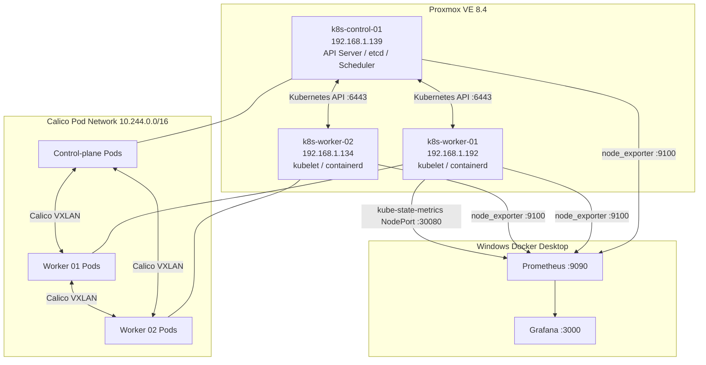
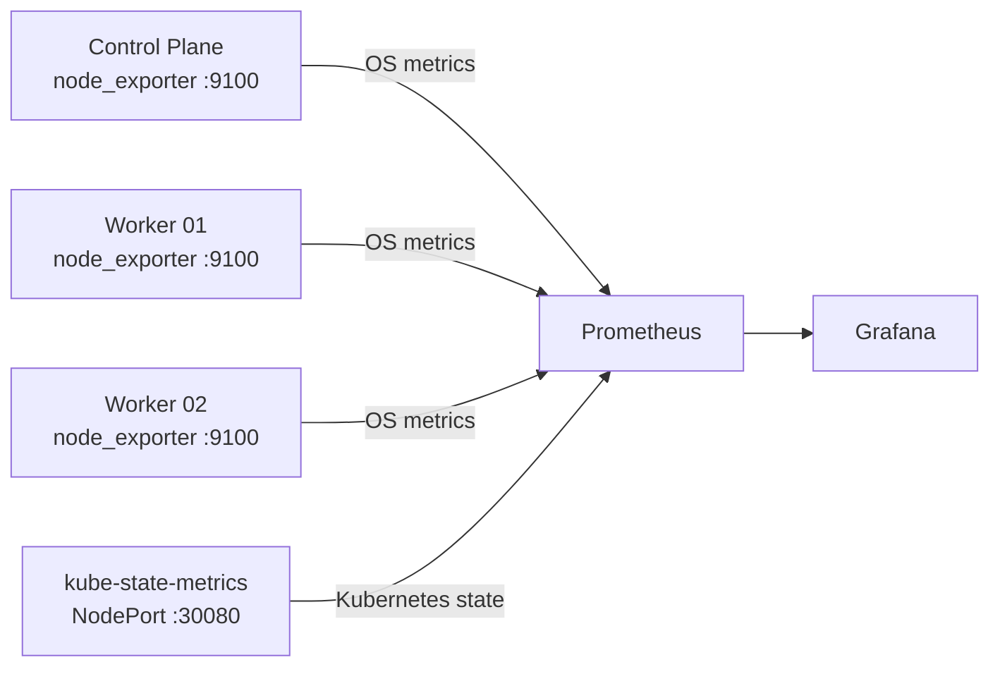

# ☸️ Kubernetes Homelab on Proxmox

<div align="center">


**Three-node Kubernetes cluster built from scratch on Proxmox with Calico networking and external Prometheus/Grafana observability.**

[Architecture](#architecture) • [Cluster](#cluster-inventory) • [Observability](#observability) • [Build](#build-path) • [Troubleshooting](#troubleshooting) • [Repository](#repository-structure)

</div>

---

## Overview

This project documents a three-node Kubernetes lab running on Proxmox VE. The cluster was built directly with `kubeadm`, `kubelet`, `kubectl`, `containerd`, and Calico rather than using a pre-packaged Kubernetes distribution.

The design separates the physical LAN from the Kubernetes Pod network and keeps monitoring outside the cluster on a Windows Docker Desktop host. Prometheus scrapes Linux node metrics through node-exporter and Kubernetes object state through kube-state-metrics. Grafana visualises both infrastructure health and cluster state.

## Cluster Inventory

| Role | Hostname | VM ID | LAN IP | vCPU | RAM | Disk |
|---|---|---:|---|---:|---:|---:|
| Control plane | `k8s-control-01` | 150 | `192.168.1.139` | 2 | 4 GB | 40 GB |
| Worker | `k8s-worker-01` | 151 | `192.168.1.192` | 4 | 8 GB | 60 GB |
| Worker | `k8s-worker-02` | 152 | `192.168.1.134` | 4 | 8 GB | 60 GB |

### Technology Stack

| Layer | Technology |
|---|---|
| Hypervisor | Proxmox VE 8.4 |
| Guest OS | Ubuntu 22.04.5 LTS |
| Kubernetes | v1.37.1 |
| Runtime | containerd 2.2.1 |
| CNI | Calico 3.33 |
| Overlay | VXLAN |
| Node network | `192.168.1.0/24` |
| Pod network | `10.244.0.0/16` |
| Metrics | Prometheus |
| Dashboards | Grafana |
| Linux metrics | node-exporter |
| Kubernetes state | kube-state-metrics |

## Architecture



Standalone Mermaid source files are available under [`diagrams/`](diagrams/).

## Networking

The node network and Pod network are deliberately non-overlapping:

```text
Physical LAN: 192.168.1.0/24
Pod CIDR:     10.244.0.0/16
```

An earlier bootstrap used `192.168.0.0/16` for Pods, which overlapped the physical LAN. The cluster was reset before workloads were introduced and rebuilt with `10.244.0.0/16`.

Calico provides Pod-to-Pod connectivity using VXLAN encapsulation, with BGP disabled for this lab.

## Observability



### Metrics layers

**node-exporter** provides:
- CPU
- memory
- filesystem
- network
- disk I/O
- load
- uptime

**kube-state-metrics** provides:
- node readiness
- Pod phase
- namespace inventory
- deployment state
- desired vs available replicas
- container restart counts
- Pod placement by node

The Grafana dashboard export is stored at:

[`monitoring/grafana/kubernetes-homelab-full-overview.json`](monitoring/grafana/kubernetes-homelab-full-overview.json)

## Build Path

1. Clone Ubuntu cloud-init template into three Proxmox VMs.
2. Regenerate machine IDs and set unique hostnames.
3. Disable swap.
4. Load `overlay` and `br_netfilter`.
5. Enable bridge netfilter and IPv4 forwarding.
6. Install containerd.
7. Configure `SystemdCgroup = true`.
8. Install kubeadm, kubelet, and kubectl.
9. Initialise the control plane.
10. Install Calico.
11. Join two workers.
12. Install node-exporter.
13. Deploy kube-state-metrics.
14. Expose kube-state-metrics to the external Prometheus instance.
15. Import the Grafana dashboard.

Detailed notes are in [`docs/build-notes.md`](docs/build-notes.md).

## Useful Validation Commands

From the Proxmox host:

```bash
qm guest exec 150 -- kubectl \
  --kubeconfig=/etc/kubernetes/admin.conf \
  get nodes -o wide
```

```bash
qm guest exec 150 -- kubectl \
  --kubeconfig=/etc/kubernetes/admin.conf \
  get pods -A -o wide
```

Check kube-state-metrics:

```bash
qm guest exec 150 -- kubectl \
  --kubeconfig=/etc/kubernetes/admin.conf \
  get svc -n kube-system
```

Check node-exporter:

```bash
curl http://192.168.1.139:9100/metrics
curl http://192.168.1.192:9100/metrics
curl http://192.168.1.134:9100/metrics
```

## Troubleshooting

### Cloned VMs received duplicate identity

The original template carried a populated machine ID, causing clones to initially share DHCP identity. Each clone was corrected with a unique hostname and regenerated machine ID.

### kubeadm appeared to time out through Proxmox

A `qm guest exec` timeout does not necessarily mean the process inside the guest stopped. Long-running commands can continue after Proxmox stops waiting for the response.

### Nodes stayed NotReady before Calico

This is expected. Kubernetes requires a functioning CNI before normal Pod networking is available.

### kube-state-metrics service could not be patched to NodePort

The standard service was headless with `clusterIP: None`. A headless Service cannot be converted directly into NodePort, so a second Service was created specifically for external Prometheus access.

More detail: [`docs/troubleshooting.md`](docs/troubleshooting.md).

## Repository Structure

```text
.
├── README.md
├── diagrams/
│   ├── 01-cluster-architecture.mmd
│   ├── 02-observability-flow.mmd
│   └── 03-network-flow.mmd
├── docs/
│   ├── architecture-decisions.md
│   ├── build-notes.md
│   └── troubleshooting.md
├── experiments/
│   └── cpu-stress.yaml
├── manifests/
│   ├── calico-installation.yaml
│   └── kube-state-metrics-nodeport.yaml
└── monitoring/
    ├── grafana/
    │   └── kubernetes-homelab-full-overview.json
    └── prometheus/
        └── prometheus.yml
```

## Key Engineering Lessons

- VM templates must be generalised before cloning.
- Pod networks must not overlap with physical LANs or VPN ranges.
- kubeadm bootstraps the control plane, but a CNI is still required before the cluster becomes operational.
- kubelet and containerd serve different responsibilities.
- Kubernetes state metrics and Linux host metrics answer different operational questions.
- NodePort is useful for controlled lab integrations, but production monitoring would normally use in-cluster service discovery and authenticated scrape paths.
- Observability is easier to understand when metrics are separated by source and responsibility.

## Next Enhancements

- Add kubelet/cAdvisor scraping for per-Pod CPU and memory
- Add Alertmanager and alert rules
- Add persistent storage experiments
- Add Ingress
- Add NetworkPolicy exercises
- Test worker failure and Pod rescheduling
- Add HPA experiments
- Deploy a multi-service workload
