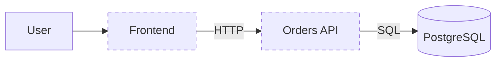

# Orders Application Baseline

Related issue: #2

## Purpose

Orders is the deliberately lightweight workload for the platform-modernization and migration project. Its business logic stays small so the engineering focus remains on containerization, Kubernetes, Helm, GitOps, observability, security, autoscaling, persistence, migration and recovery.

This baseline defines workload requirements only. It does not select the Azure/AKS target architecture.

## Architecture



### Components

| Component | Responsibility | State |
| --- | --- | --- |
| Frontend | Basic orders user interface and API client | Stateless |
| Orders API | Order operations, health/readiness and metrics | Stateless |
| PostgreSQL | Persistent order data | Stateful |

Redis, queues and caching are excluded unless a later functional requirement justifies them.

## Minimum behaviour

The API baseline requires approximately:

- `GET /orders`
- `POST /orders`
- `GET /orders/{id}`
- `GET /healthz`
- `GET /readyz`
- `GET /metrics`

Exact implementation details belong to the containerization/application implementation issue.

## Dependency boundaries

Required communication:

```text
Frontend -> Orders API
Orders API -> PostgreSQL
```

The frontend has no direct database dependency. This boundary will later support meaningful Kubernetes Services and NetworkPolicy testing.

## Health and observability

The workload must provide:

- a liveness/health endpoint;
- a readiness endpoint capable of representing whether the API can serve traffic;
- Prometheus-compatible application metrics;
- useful application logs for later failure and troubleshooting exercises.

Probe timings, scraping configuration, dashboards and alerting are deferred to later issues.

## Configuration and secrets

Expected non-secret configuration includes the frontend API location, database host/name and application runtime settings.

Database credentials are secrets. Real credentials must never be committed to Git. The production secret-management mechanism is deliberately deferred to the security/GitOps work.

## Portability requirement

Application code must not depend directly on Proxmox-specific or Azure-specific APIs. The workload must remain capable of running on the existing Kubernetes cluster and on a future Kubernetes target.

## Deferred architecture decisions

Issue #2 deliberately does not decide:

- AKS topology or node pools;
- Azure VNet/subnet design;
- Azure storage architecture;
- PostgreSQL in Kubernetes versus a managed Azure database;
- ACR design;
- Azure identity design;
- Azure monitoring architecture;
- final migration/cutover mechanism;
- final persistent-data migration mechanism.

Those decisions will be made later from measured workload and platform requirements.
